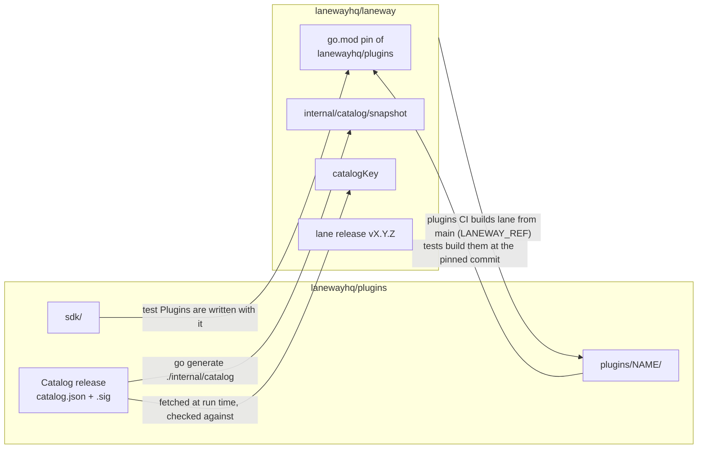
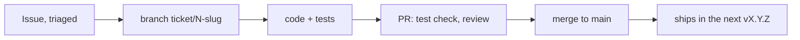
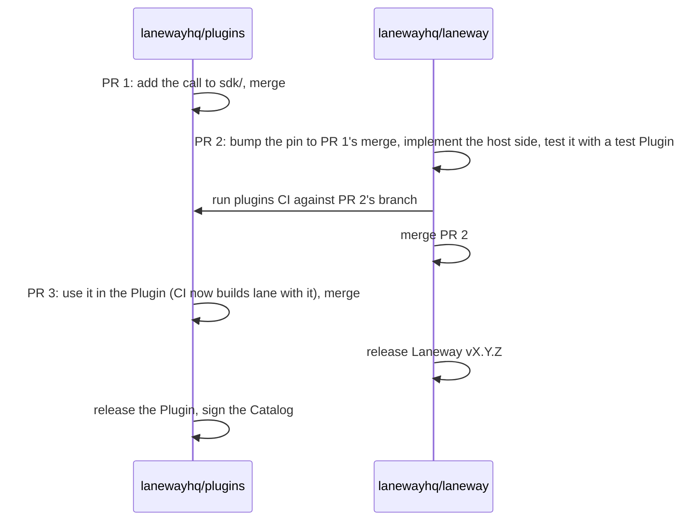
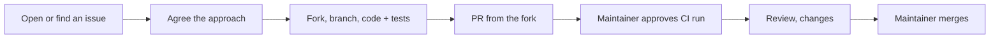
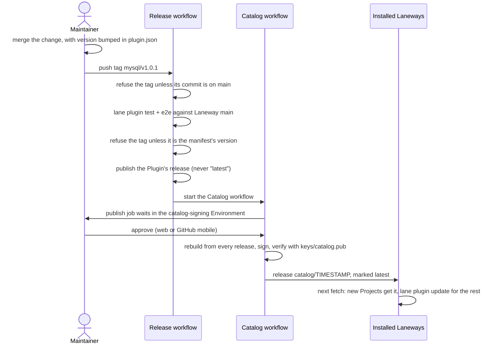
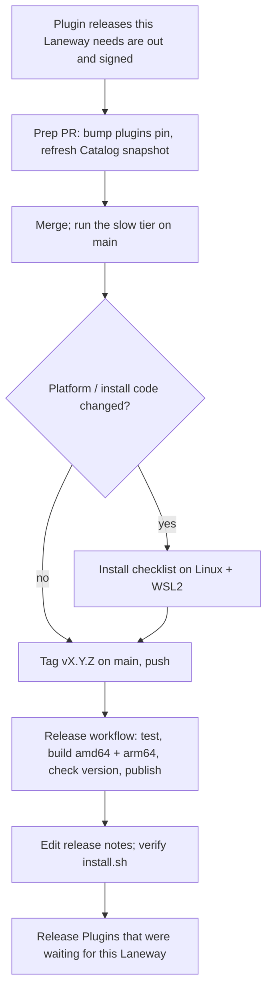

# Development flow: features, bug fixes, contributions and releases

How a change gets from an idea to a Laneway user, across the two repositories:

- **[lanewayhq/laneway](https://github.com/lanewayhq/laneway)**: the `lane` binary and its daemon.
- **[lanewayhq/plugins](https://github.com/lanewayhq/plugins)**: the Go SDK for Plugins, the first-party Plugins (Laravel, Rails, Vite, the Engines, the Generators) and the signed Catalog that lists them.

Words like Plugin, Catalog, Recipe and Pin mean what [GLOSSARY.md](../GLOSSARY.md) says they mean. [ADR-0007](adr/0007-plugins-are-wasm-effects-from-a-signed-catalog.md) explains why the Plugins live in their own repository and are fetched from a signed Catalog.

## How the two repositories depend on each other



Four links matter in practice:

| Link | Direction | Kept in sync by |
| --- | --- | --- |
| Laneway's tests build the first-party Plugins from `github.com/lanewayhq/plugins` at the version `go.mod` pins. | plugins → laneway | Bumping the pin: `go get github.com/lanewayhq/plugins@<commit>` |
| The binary embeds a snapshot of the signed Catalog, used only when it has never been able to fetch one. | plugins → laneway | `go generate ./internal/catalog` before a Laneway release |
| Plugins CI builds `lane` from Laneway's `main` (the `LANEWAY_REF` variable) and tests every Plugin against it. | laneway → plugins | Nothing: it always follows `main`. Run the plugins CI by hand against a Laneway branch to test a change before it lands. |
| Installed Laneways fetch the latest Catalog release and only accept it if it's signed with `catalogKey`. | plugins → users | The Catalog signing flow ([below](#releasing-a-plugin-and-signing-the-catalog)) |

The consequence: **a Plugin fix reaches users without a Laneway release.** Once its release is in a signed Catalog, new Projects get it straight away and existing installs get it with `lane plugin update`.

## Rules that apply to every change

Both repositories have the same protection on `main`:

- **Pull requests only.** No direct pushes, no force pushes.
- **The `test` check must pass.** In laneway it's gofmt, `go vet` and `go test ./...`. In plugins it's gofmt, `go vet`, the SDK's tests, `lane plugin test` for every Plugin and the e2e tests against a `lane` built from Laneway's `main`.
- **Code owners, no required approval.** [CODEOWNERS](../.github/CODEOWNERS) makes the maintainer (`mrsafalpiya`) the owner of everything, and above all of CI, the release workflows, `install.sh`, the Catalog key (`internal/catalog/`) and, in plugins, `keys/`, so every pull request asks for their review. Merging doesn't need an approval: the maintainer is the only one with write access, so nothing merges without them, and their own pull requests (which GitHub won't let them approve) merge once `test` is green. Give anyone else write access only together with bringing back a required code-owner approval.

Conventions, as the history already follows them:

- **Branches:** `ticket/<issue>-<slug>` for work on an issue, `spec/<issue>-<slug>` for a spec made of several tickets, and `fix/…`, `chore/…`, `docs/…`, `ci/…` otherwise.
- **Commits:** `<type>: <what is now true, as a sentence>`. The type is `feat`, `fix`, `docs`, `test`, `refactor`, `chore` or `ci`. For example: `fix: the Rails tests' stub Ruby accepts bin/rails however the kernel passes it`. Keep commits small and keep the history readable: pull requests are merged with a merge commit, not squashed.
- **Pull requests:** say what changes for the user, link the issue (`Fixes #81`), and say how it was tested beyond CI (the slow tier, the [install checklist](install-checklist.md), a real Project).
- **Words:** use the glossary's terms in code, docs, issues and commits. A decision that changes the design gets an ADR in [docs/adr](adr).

### Issues and triage

Issues for both repositories live in GitHub Issues. A Laneway bug that turns out to be a Plugin's moves to lanewayhq/plugins (`gh issue transfer`). New issues get `needs-triage` and leave triage with one of these labels ([docs/agents/triage-labels.md](agents/triage-labels.md)):

| Label | Meaning |
| --- | --- |
| `needs-triage` | The maintainer hasn't looked yet. |
| `needs-info` | Waiting for the reporter. |
| `ready-for-agent` | Fully specified: an AI agent can take it unattended. |
| `ready-for-human` | Needs a person: judgement, a real machine, credentials. |
| `wontfix` | Won't be done; closed with the reason. |

Add `bug` or `enhancement` beside it. Larger features start as a spec issue with sub-issues for its tickets (as #48 did for the Plugin system).

## Feature flow

### A feature in Laneway only



1. Start from a triaged issue (`ready-for-agent` or `ready-for-human`). If it changes a design decision, write or amend an ADR first, and add any new term to the glossary.
2. Branch from `main`: `git switch -c ticket/<N>-<slug> origin/main`.
3. Write the tests with the code. The fast suite (`go test ./...`) runs a real daemon with a fake container engine. If the change touches container engines, also run the slow tier: `LANEWAY_SLOW=1 go test ./e2e -run RealContainerEngine`. If it touches `internal/platform` or `lane install` / `lane doctor`, go through the [install checklist](install-checklist.md) on Linux and WSL2.
4. Update the README, the guides in [docs/guides](guides) and the glossary when what users see changes.
5. Open the pull request (`Fixes #N`), get `test` green and review, merge.
6. If the change touches anything Plugins rely on (the Plugin API, Effects, Events, the Catalog format, how Recipes are detected), run the plugins CI against `main` straight after merging so a break shows up now rather than on the next plugins PR: `gh workflow run ci.yml -R lanewayhq/plugins -f laneway_ref=main`. Better, run it against your branch before merging: `-f laneway_ref=ticket/<N>-<slug>`.

It reaches users in the next Laneway release.

### A feature in a first-party Plugin only

1. Issue in lanewayhq/plugins, branch `ticket/<N>-<slug>`.
2. Change the Plugin under `plugins/<name>/`, and add or update its `lane plugin test` cases under `plugins/<name>/testdata/`. `lane plugin test --update plugins/<name>` rewrites the golden files; review their diff, it's the Plugin's behaviour.
3. Run what CI runs, with a `lane` built from Laneway's `main`:
   ```sh
   go run ./cmd/plugins build
   LANE=/path/to/lane go run ./cmd/plugins test
   LANE=/path/to/lane LANEWAY_SRC=/path/to/laneway go test -tags e2e ./e2e
   ```
4. Bump `version` in `plugins/<name>/plugin.json`, in this pull request or in a later one before release. A new feature is a minor bump, a fix a patch bump.
5. Pull request, `test` green, review, merge.
6. [Release the Plugin](#releasing-a-plugin-and-signing-the-catalog). Then, at a convenient time, [bump Laneway's pin](#keeping-laneway-in-step-with-the-plugins) so Laneway's tests use the new version.

### A feature that spans both repositories

Typically a new Effect, Event or SDK call, which Laneway must apply and a Plugin then uses. The SDK lives in lanewayhq/plugins and Laneway's own test Plugins are written with it, so the order is:



**Release Laneway before the Plugin that needs it.** Plugins CI tests against Laneway's `main`, not against the last release, so a green Plugin release says nothing about Laneways already installed. A Plugin released before the Laneway that understands it breaks for every user on the older Laneway. Until 1.0 the Plugin API version (`api_version` in `plugin.json`) only accepts the current version, so it won't catch this for you.

## Bug fix flow

The same flow as a feature, with three differences:

1. **Reproduce it in a test first.** The test fails on `main` and passes with the fix. For a Plugin, that's usually a new `lane plugin test` case or an e2e test.
2. **Branch** `fix/<N>-<slug>` (or `ticket/<N>-<slug>`), and the pull request says `Fixes #N`.
3. **Ship it quickly:**
   - **Bug in a Plugin:** merge with a patch bump of its version, release the Plugin and sign the Catalog. That's the whole fix for users: no Laneway release is needed. Tell reporters to run `lane plugin update <name>`. Then bump Laneway's pin. (#81, MySQL readiness on Podman, was this case: fixed in mysql 1.0.1.)
   - **Bug in Laneway:** merge, then cut a patch release, `vX.Y.Z+1`, from `main`. There are no release branches: until 1.0, `main` is always releasable, so a fix ships with whatever else has merged since. If `main` holds something that mustn't ship yet, hold the fix's release until it's ready, or revert that change first.
   - **Bug in both** (a Laneway bug a Plugin works around, say): fix Laneway, release it, then release the Plugin without the workaround. Same order as a feature.

**Security issues** don't go in a public issue. Reporters contact the maintainer privately, and the fix is reviewed and released before it's described. A leaked Catalog signing key is the worst case: see [keys/README.md](https://github.com/lanewayhq/plugins/blob/main/keys/README.md) in lanewayhq/plugins for replacing it, which needs a Laneway release first.

## External contributions

### For contributors



1. **Start with an issue** unless the change is small and obvious (a typo, a clear bug with a one-line fix). Pull requests aren't a feature-request channel: one without an agreed issue may be closed in favour of discussing it first. Issues labelled `good first issue` or `help wanted` are open for anyone to take; say in the issue that you are.
2. **Fork** the repository and branch from `main`.
3. **Build and test** as in the feature flow above: `go test ./...` in laneway; in plugins, `lane plugin test` for every Plugin you changed, with a `lane` built from Laneway's `main`. Run `gofmt -w` on your Go files.
4. **Follow the conventions:** commit messages as above, the glossary's words, tests with the change. Don't bump a Plugin's version and don't touch `keys/`, `.github/` or `install.sh` unless the issue asks for it; the maintainer handles versions and releases.
5. **Open the pull request** against `main` with `Fixes #N` and how you tested it.

Contributions are licensed under the Apache License 2.0, as the repositories are.

**Your own Plugin doesn't need to be in lanewayhq/plugins.** Anyone can publish a Plugin in their own repository, under any license, and users add it with `lane plugin add github.com/<owner>/<repo>`. See the [Plugin authoring guide](https://github.com/lanewayhq/plugins/blob/main/docs/authoring.md). lanewayhq/plugins only holds the first-party Plugins in the Catalog; propose a new one there in an issue first.

### For the maintainer

1. **Approve the CI run.** Workflows from a first-time contributor's fork wait for approval ("Approve and run" on the pull request). Read the diff before approving: it runs on GitHub's runners. Fork runs get no secrets; plugins CI still works because lanewayhq/laneway is public, so it checks Laneway out with the run's own token.
2. **Review** as for any change, and above all anything under CODEOWNERS' named paths. A contribution must never change `catalogKey`, `keys/`, the Catalog or the release and signing workflows without an issue that asked for it.
3. **Finish it if needed.** If small changes are left, push them to the contributor's branch ("Allow edits by maintainers" is on by default), or merge and follow up. Bump a Plugin's version in a separate pull request at release time.
4. **Merge** with a merge commit, and thank them. Then release as usual.

## Releasing a Plugin and signing the Catalog

Each first-party Plugin is released on its own, by a tag. The full detail is in [docs/releasing.md](https://github.com/lanewayhq/plugins/blob/main/docs/releasing.md) in lanewayhq/plugins.



1. Make sure `plugins/<name>/plugin.json` on `main` has the new `version`.
2. Tag that commit and push the tag, **one tag per push** (GitHub starts no workflows for a push of more than three tags):
   ```sh
   git switch main && git pull
   git tag mysql/v1.0.1 && git push origin mysql/v1.0.1
   ```
3. The **Release** workflow refuses a tag whose commit isn't on `main` or isn't the manifest's version, tests the Plugin against Laneway's `main`, publishes the release (archive, `plugin.json`, `SHA256SUMS`) and starts the **Catalog** workflow. Nothing so far reaches users.
4. **Approve the signing: your only manual step.** The Catalog workflow's `publish` job waits for you in the `catalog-signing` Environment, and GitHub notifies you. On the run's page, click **Review deployments**, tick `catalog-signing` and click **Approve and deploy**, or approve it in the GitHub mobile app. It rebuilds the Catalog from every Plugin release, signs it and publishes it as the latest release, where Laneway fetches it. Releasing several Plugins at once starts several runs: approve one once all their releases are out, and the rest find nothing new and publish nothing.
5. Check it: `gh release list -R lanewayhq/plugins` shows a new `Catalog <date>` marked Latest, and on a machine with Laneway, `lane plugin update <name>` installs the new version.

A published tag and release are never reused. If a release is wrong, fix it and release the next patch version.

## Releasing Laneway

Laneway releases are `vX.Y.Z` tags on `main`. Until 1.0, a minor bump is for new features or anything that changes commands, config or the Plugin API; a patch bump is for fixes only.



1. **Plugins first.** Every Plugin release this Laneway needs, or that should be in its built-in Catalog snapshot, is out and in a signed Catalog.
2. **Prep pull request** (`chore/release-vX.Y.Z`):
   ```sh
   go get github.com/lanewayhq/plugins@<plugins main commit or tag> && go mod tidy
   go generate ./internal/catalog     # refreshes the Catalog snapshot from the published, signed Catalog
   go test ./...
   ```
   The snapshot only changes if the published Catalog is signed with the key built into Laneway; `gensnapshot` refuses anything else. Merge it.
3. **Run the slow tier on `main`** against real Docker and Podman, and wait for it to pass:
   ```sh
   gh workflow run ci.yml --ref main && gh run watch
   ```
   It runs nightly too; a failing nightly blocks a release until it's fixed or understood.
4. **Manual checks**, if `internal/platform`, `lane install` or `lane doctor` changed: the [install checklist](install-checklist.md) on Linux and WSL2, with the results recorded in its table.
5. **Tag and push:**
   ```sh
   git switch main && git pull
   git tag v0.2.0 && git push origin v0.2.0
   ```
6. **The Release workflow** runs the tests again, builds `lane` for linux/amd64 and linux/arm64 with the version stamped in, checks that `lane version` prints `lane v0.2.0`, and publishes `lane_linux_amd64.tar.gz`, `lane_linux_arm64.tar.gz` and `SHA256SUMS` with generated notes. Asset names carry no version, so `releases/latest/download/…` always serves the newest release, which `install.sh` relies on.
7. **Finish:** edit the generated notes to lead with what changed for users and any upgrade steps. Then check it on a clean machine or container:
   ```sh
   curl -fsSL https://raw.githubusercontent.com/lanewayhq/laneway/main/install.sh | sh
   lane version     # lane v0.2.0
   ```
8. **Then release the Plugins** that were waiting for this Laneway.

If the workflow fails before publishing, delete the tag (`git push origin :v0.2.0 && git tag -d v0.2.0`), fix on `main`, and tag again. Once a release is published, never move or reuse its tag: release the next patch instead.

## Keeping Laneway in step with the Plugins

After any change to lanewayhq/plugins that Laneway's tests should see (a Plugin release, an SDK change), and before every Laneway release:

```sh
go get github.com/lanewayhq/plugins@<commit or tag>
go mod tidy
go generate ./internal/catalog   # only needed when a new Catalog was signed
go test ./...
```

Commit as `chore: Laneway's tests use lanewayhq/plugins <what changed>` and open a pull request. A stale pin doesn't break users, since they get Plugins from the Catalog, but it means Laneway's tests run against old Plugins.

## Quick reference

| I want to… | Repo | Steps |
| --- | --- | --- |
| Add a Laneway feature | laneway | issue → `ticket/N-slug` → tests → PR → merge → next `vX.Y.Z` |
| Fix a Laneway bug | laneway | failing test → fix → PR `Fixes #N` → merge → patch release |
| Change a Plugin | plugins | issue → branch → `lane plugin test` cases → bump `plugin.json` → PR → merge → tag `<plugin>/v<version>` → approve signing |
| Add an Effect / Event / SDK call | both | SDK PR (plugins) → pin + host side (laneway) → Plugin uses it (plugins) → release Laneway → release Plugin |
| Ship a Plugin fix to users | plugins | release the Plugin and sign the Catalog; users run `lane plugin update` |
| Release Laneway | laneway | Plugins first → pin + snapshot PR → slow tier → checklist → tag `vX.Y.Z` → verify `install.sh` |
| Test a Laneway branch against every Plugin | plugins | `gh workflow run ci.yml -R lanewayhq/plugins -f laneway_ref=<branch>` |
| Run the slow tier | laneway | `gh workflow run ci.yml --ref <branch>` |
